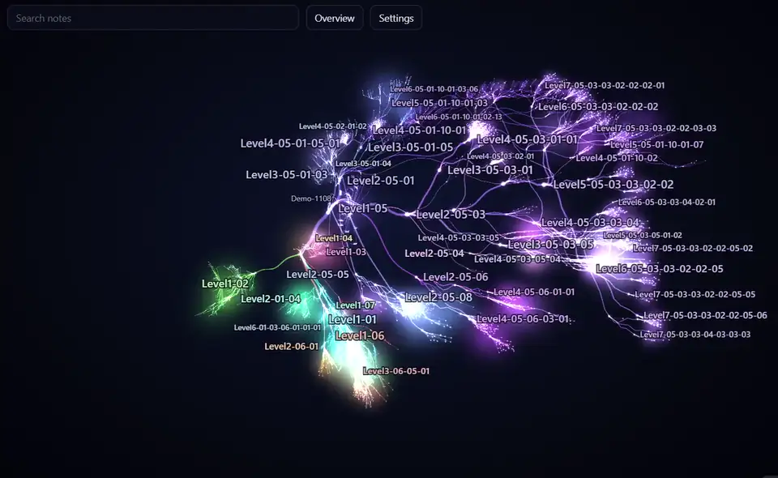
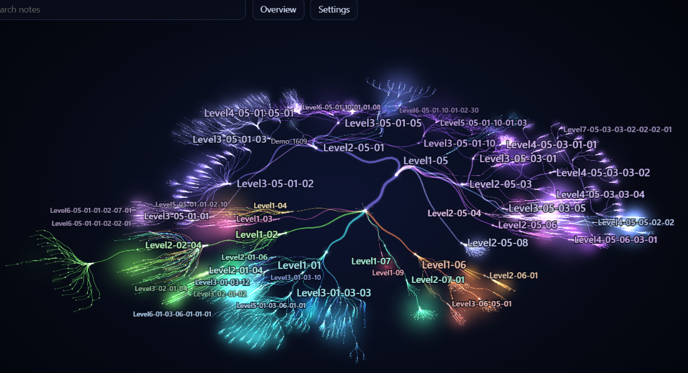
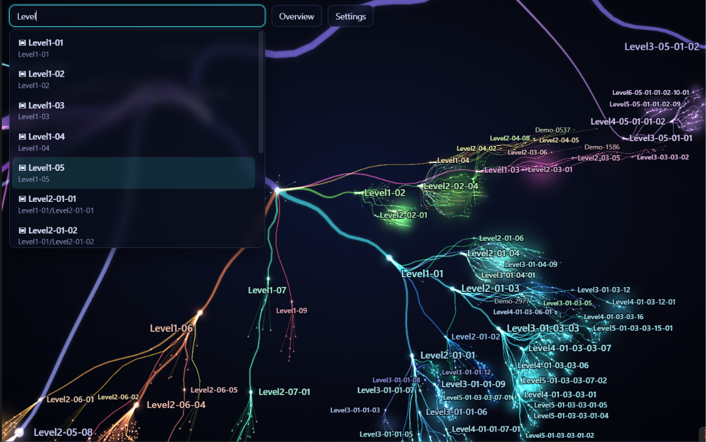

[English](README.md) · **Čeština**

# Brain Map

Brain Map kreslí tvůj vault v Obsidianu jako neuronovou síť: složky tvoří větve, poznámky listy a odkazy je propojují. Prohlédni si strukturu ve 2D nebo 3D, najdi poznámku podle názvu a otevři ji přímo z mapy.

[Pusť si 34sekundové video](assets/brain-map-demo.mp4)

## Funkce

| Funkce | Co dělá |
|--------|---------|
| Mapa vaultu | Zobrazuje složky, poznámky a odkazy z tvého vaultu ve 2D nebo 3D. |
| Hledání | Najde složky a soubory podle názvu a přeletí k vybranému výsledku. |
| Větve | Sbal složky pod kořenem vaultu nebo použij **Expand all** a **Collapse all**. |
| Panel výběru | Ukáže název, cestu a počty příchozích a odchozích odkazů uzlu, u složek také počet přímých dětí včetně podsložek a souborů mimo Markdown. Soubory otevřeš přes **Open note**, složky pod kořenem vaultu sbalíš či rozbalíš přes **Collapse** / **Expand**. |
| Seznamy souborů a vazeb | Kliknutím na nenulový počet zobrazíš přímé děti nebo propojené poznámky; výběrem položky k ní přeletíš a přes **Back** se vrátíš. Seznam ukáže nejvýše 500 položek. |
| Zvýraznění vazeb | Vybraný uzel ukáže odchozí a příchozí odkazy ve dvou barvách s pulzy ve směru odkazu, i když je **Dependencies** vypnuté. |
| Další soubory | Volitelně zahrne PDF, obrázky a další soubory i s odkazy z poznámek. |
| Barvy | Vyber si **Aurora**, **Neon night** nebo **Coral and amber**. |
| Tagy | Tagy z frontmatteru i z textu (`#tag`), bez ohledu na velikost písmen, vnořený `#a/b` je jeden tag. Panel výběru ukáže tagy poznámky, vybraný tag ukáže své poznámky s přeletem a **Back**. Na mapě leží tagy těsně za obrysem mapy ve 2D a kolem ní ve 3D, vazby k nim jsou karmínové. Hledání nabízí i tagy, dotaz začínající `#` najde jen tagy. |

## Instalace

Potřebuješ Obsidian 1.8.7 nebo novější.

Otevři **Settings → Community plugins → Browse**, vyhledej **Brain Map**, nainstaluj ho a zapni.

## Ovládání

| Akce | Jak na to |
|------|-----------|
| Otevření mapy | Klikni na ikonu mozku v postranní liště nebo spusť příkaz **Brain Map: Open map**. |
| Přepnutí 2D / 3D | Otevři **Settings** v mapě a v části **View** vyber **2D** nebo **3D**. |
| Výběr uzlu (2D / 3D) | Klikni nebo klepni na uzel: vybere se a pohled k němu přiletí. Kliknutím nebo klepnutím do prázdna výběr zrušíš. |
| Otevření souboru | Ve 2D na soubor dvakrát klikni, dvakrát klepni nebo ho podrž 550 ms. V obou pohledech ho můžeš vybrat a v panelu stisknout **Open note**. |
| Sbalení nebo rozbalení složky | U složek pod kořenem vaultu: ve 2D na složku dvakrát klikni, dvakrát klepni nebo ji podrž 550 ms. V obou pohledech použij **Collapse** nebo **Expand** v panelu výběru. |
| Posun a přiblížení ve 2D | Tažením mapu posuneš, kolečkem nebo sevřením a roztažením dvou prstů změníš přiblížení. |
| Otáčení, posun a přiblížení ve 3D | Tažením otáčíš, pravým tlačítkem s tažením nebo Shift s tažením posouváš, kolečkem měníš přiblížení. Na dotykové obrazovce otáčej jedním prstem, dvěma posouvej a měň přiblížení. |
| Klávesnice ve 3D | Když má plátno fokus, R ukáže celek, F přiletí k výběru a Esc ho zruší. WASD + Q/E pohybují kamerou, se Shiftem rychleji. Esc zruší výběr i ve 2D. |
| Procházení souborů a vazeb | Klikni nebo klepni na počet v panelu výběru, pak na položku. **Back** vrátí předchozí uzel, **Clear selection** tuto historii vymaže. Esc nebo klik mimo seznam ho zavře. |
| Hledání (2D / 3D) | Do **Search notes** napiš alespoň dva znaky, vyber výsledek nebo stiskni Enter pro první shodu. |
| Návrat na celek nebo detail | **Overview** ukáže celou mapu. Když je vidět celá mapa a uzel je vybraný, tlačítko se změní na **Detail** a přeletí zpět k uzlu. Ani jedno nemění sbalení složek ani výběr. |
| Přehrání historie vaultu | Tlačítko s hůlkou v liště mapy přehraje, jak složky a soubory postupně vznikaly, za 20-60 sekund podle velikosti vaultu. Pohled se s rostoucí mapou oddaluje a skončí na celku; když sám přiblížíš nebo posuneš, automatika se vypne. Mezerník pozastaví, druhý klik zastaví. Datum vzniku se bere z `created` nebo `date` ve frontmatteru, jinak z časů souboru. |
| Obnovení stromu | Po přidání, smazání, přesunu nebo přejmenování souborů stiskni **Refresh map** v panelu **Settings**, ikonu obnovení v záhlaví karty mapy nebo spusť **Brain Map: Refresh map**. Odkazy mezi existujícími uzly se aktualizují, když je Obsidian rozliší. |

## Nastavení

Volby zobrazení najdeš v panelu **Settings** v mapě; karta nastavení pluginu navíc obsahuje **Excluded folders** a **Excluded tags**. Rozhraní je anglicky.

| Nastavení | Co dělá | Výchozí hodnota |
|-----------|---------|-----------------|
| **View** | Přepíná mezi 2D a 3D. | **2D** |
| **Palette** | Mění barvy větví. | **Aurora** |
| **Depth (3D)** | Ve 2D zmenší a ztlumí vzdálenější uzly, takže mapa působí prostorově. Skutečné 3D zapneš ve **View**. | Zapnuto |
| **Dependencies** | Zobrazuje odkazy mezi poznámkami a při zapnutém **Other files** i odkazy na další soubory. | Vypnuto |
| **Other files** | Zahrne i jiné soubory než Markdown poznámky. | Vypnuto |
| **Orbit when idle** | Po chvíli bez ovládání začne otáčet 3D pohledem. | Zapnuto |
| **Tag links** | Po výběru poznámky ukáže jen její tagy a vazby k nim. | Vypnuto |
| **All tags** | Ukáže na mapě všechny tagy, vazby jen u vybraného uzlu. | Vypnuto |
| **Excluded folders** | Jedna položka na řádek: název vyloučí všechny takto pojmenované složky, cesta jako `Projects/Old` vyloučí jen tuto složku od kořene vaultu; lomítko na začátku či konci se ignoruje. Změna se projeví po opuštění pole; skryté cesty se vynechávají vždy. | `_templates`, `Clippings`, `node_modules`, `__pycache__` |
| **Excluded tags** | Jeden tag na řádek, bez `#`; vyloučené tagy zmizí z mapy, hledání i panelu. | Prázdné |

## Mobil a tablet

Na telefonu a tabletu používej dotyková gesta popsaná výše. Otevření souboru na mobilu nahradí mapu ve stejné záložce; navigací Zpět v Obsidianu se vrátíš k uloženému záběru a výběru. Na počítači se soubory otevírají v nové záložce.

## Soukromí

Brain Map neposílá síťové požadavky. Mapu sestavuje z cest souborů ve vaultu a z odkazů rozlišených Obsidianem.

Změna voleb zobrazení, vyloučených složek nebo sbalených větví ukládá nastavení do `data.json` ve složce pluginu.

Diagnostiku zapisuje pouze příkaz **Brain Map: Export diagnostics** a potřebuje k tomu otevřenou mapu. Do složky pluginu zapíše `diagnostika.json` se jménem vaultu, cestami souborů, vyloučenými složkami, rozlišenými odkazy, verzí aplikace, příznaky platformy a geometrií pohledu. Před sdílením soubor zkontroluj: názvy a cesty mohou být soukromé.

Stejný příkaz zapíše geometrii do `Brain-Map-diagnostika.md` v kořeni vaultu. Aktualizuje poznámku označenou jako vlastní, nebo zvolí číslovaný název, pokud původní název zabírá jiný soubor či složka. Poznámka s geometrií neobsahuje text poznámek ani cesty souborů; jako součást vaultu se může přenést synchronizací.

## Známá omezení

- Strom složek a souborů je snímek. Změny struktury načti přes **Refresh map**.
- Hledání prochází názvy, ne obsah poznámek, a ukáže nejvýše 12 výsledků.
- **Dependencies** vykreslí nejvýše 1 500 křivek najednou (odkazy se slučují mezi viditelnými větvemi); počet skrytých ukáže vedle přepínače.
- 3D potřebuje WebGL. Když není dostupné, mapa zůstane ve 2D.

## Changelog

**0.2.1** - Historie vaultu: tlačítko s hůlkou přehraje, jak složky a soubory vznikaly, ve 2D i 3D, s automatickým přiblížením, které skončí na celku. Tagy jsou nově metalicky červené. Zatržítka v panelu Settings mapy mají v Obsidianu jen jeden rámeček.

**0.2.0** - Tagy na mapě: z frontmatteru i z textu (`#tag`), volby **Tag links** a **All tags** v Settings, tagy v hledání a v panelu výběru a **Excluded tags** v nastavení pluginu. Tagy kopírují tvar mapy ve 2D i 3D a vazby k nim jsou karmínové.

**0.1.10** - Ve 2D zůstává zvýraznění a vazby vybrané poznámky na ní i při oddálení, posun pravým tlačítkem ve 3D je na počítači 2× rychlejší, seznam palet je na Windows čitelný a vydání se staví podle lockfile.

**0.1.9** - Klikací seznamy souborů a vazeb s **Back** a opravy pro kontrolu adresáře pluginů.

**0.1.8** - První veřejná verze.

- Mapa vaultu ve 2D a 3D s větvemi složek a odkazy.
- Hledání podle názvu, animované přechody a panel výběru.
- Volitelné přílohy, tři palety a vyloučení složek.
- Dotykové ovládání a obnova mapy po otevření poznámky na mobilu.
- Navigace **Overview** / **Detail** a anglické rozhraní.

Historie před veřejným vydáním

- **0.1.7** - Přibylo **Overview** ve 2D, vystředění výběru při návratu z 3D, obnova 3D kamery po Zpět a přesun ukazatele výkonu (první snímek, výběr, paměť) do **Settings**.
- **0.1.6** - Zviditelnil se přepínač 2D/3D a do panelu **Settings** přibylo **Refresh map**.
- **0.1.5** - Přibyl 3D pohled s otáčením, ovládáním kamery a návratem do 2D při nedostupném WebGL.
- **0.1.4** - Přibyly volitelné soubory mimo Markdown a odkazy na přílohy.
- **0.1.3** - Kliknutí nebo klepnutí na uzel ve 2D ho nyní vybere a přeletí k němu.
- **0.1.2** - Opraveno nechtěné oddálení pohledu při otočení telefonu.
- **0.1.1** - Panel uzlu zůstává nad mobilní lištou a mapa má prostor i při hledání s otevřenou klávesnicí.
- **0.1.0** - První neveřejná verze: 2D mapa vaultu.

## Licence

[MIT](LICENSE). Copyright (c) 2026 Jaroslav Krčál.
