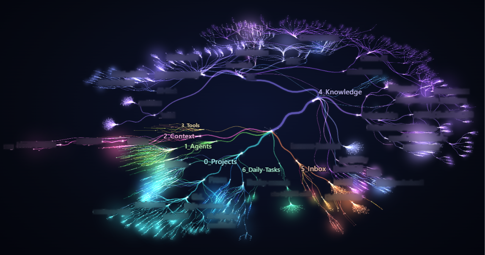
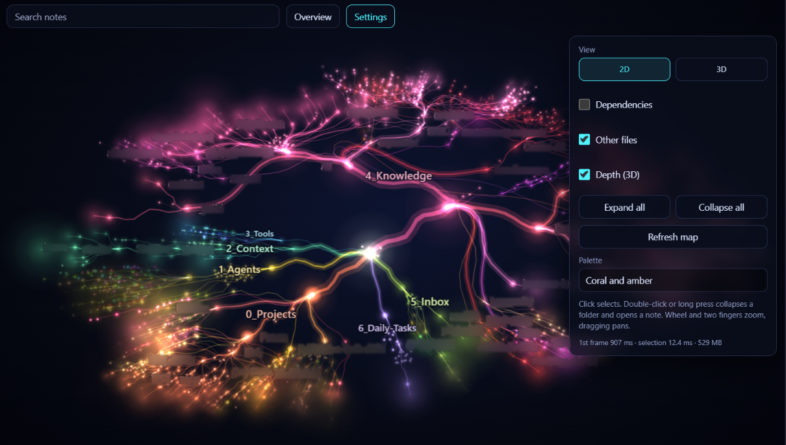
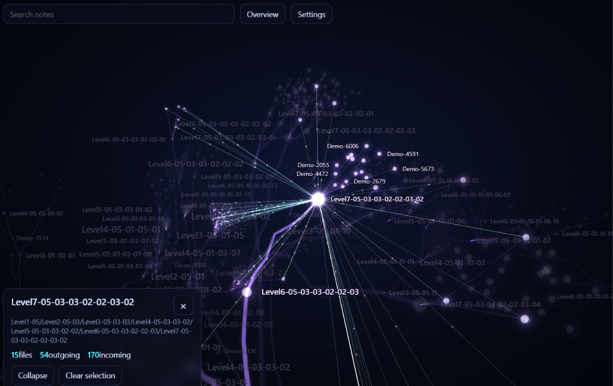
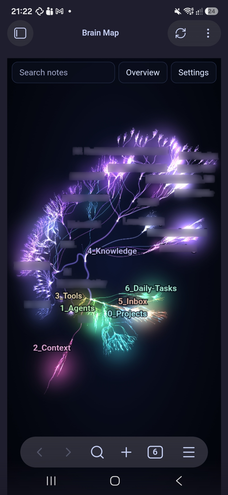

**English** · [Čeština](README.cs.md)

# Brain Map

Brain Map draws your Obsidian vault like a neural network: folders form branches, notes form leaves, and links connect them. Explore the structure in 2D or 3D, find a note by name, and open it from the map.

## Features

| Feature | What it does |
|---------|--------------|
| Vault map | Shows folders, notes and links from your vault in 2D or 3D. |
| Search | Finds folders and files by name and flies to the selected result. |
| Branches | Collapse folders below the vault root, or use **Expand all** and **Collapse all**. |
| Selection panel | Shows the node name, path and incoming/outgoing link counts; folders also show their direct children, subfolders and non-note files included. Use **Open note** for files or **Collapse** / **Expand** for folders below the vault root. |
| File and link lists | Click a nonzero count for direct children or linked notes; select an entry to fly there and use **Back** to return. Lists show up to 500 entries. |
| Link highlight | Selecting a node draws its outgoing and incoming links in two colours, with pulses in the link direction, even with **Dependencies** off. |
| Other files | Optionally includes PDFs, images and other files, with links from notes. |
| Colours | Choose **Aurora**, **Neon night**, or **Coral and amber**. |

## Installation

Requires Obsidian 1.8.7 or later.

Open **Settings → Community plugins → Browse**, search for **Brain Map**, install it and enable it.

## Controls

| Action | How |
|--------|-----|
| Open the map | Click the brain ribbon icon or run **Brain Map: Open map**. |
| Switch 2D / 3D | Open **Settings** in the map and choose **2D** or **3D** under **View**. |
| Select a node (2D / 3D) | Click or tap a node to select it and fly to it. Click or tap empty space to clear the selection. |
| Open a file | In 2D, double-click, double-tap or hold a file for 550 ms. In either view, select it and press **Open note** in the panel. |
| Collapse or expand a folder | For folders below the vault root: in 2D, double-click, double-tap or hold a folder for 550 ms. In either view, use **Collapse** or **Expand** in its selection panel. |
| Pan and zoom in 2D | Drag to pan; use the wheel or pinch with two fingers to zoom. |
| Rotate, pan and zoom in 3D | Drag to rotate; right-drag or Shift-drag to pan; use the wheel to zoom. On touchscreens, drag with one finger to rotate and use two fingers to pan and zoom. |
| Keyboard in 3D | With the canvas focused, R shows the overview, F flies to the selection and Esc clears it. WASD + Q/E move the camera; hold Shift to move faster. Esc also clears the selection in 2D. |
| Browse files and links | Click or tap a count in the selection panel, then an entry. **Back** returns to the previous node; **Clear selection** clears this history. Esc or a click outside the list closes it. |
| Search (2D / 3D) | Type at least two characters in **Search notes**; select a result or press Enter for the first one. |
| Return to an overview or detail | **Overview** shows the whole map. With the whole map in view and a node selected, the button turns into **Detail** and flies back to the node. Neither changes collapsed folders or the selection. |
| Refresh the tree | After adding, deleting, moving or renaming files, press **Refresh map** in the map's **Settings**, use the refresh icon in the map's header, or run **Brain Map: Refresh map**. Links between existing nodes update when Obsidian resolves them. |

## Settings

Display controls are in the map's **Settings** panel; the plugin settings tab also includes **Excluded folders**. The interface is in English.

| Setting | What it does | Default |
|---------|--------------|---------|
| **View** | Switches between 2D and 3D. | **2D** |
| **Palette** | Changes branch colours. | **Aurora** |
| **Depth (3D)** | In 2D, scales and dims distant nodes so the map looks layered. The real 3D view is under **View**. | On |
| **Dependencies** | Shows links between notes and, with **Other files** enabled, links to those files. | Off |
| **Other files** | Includes files other than Markdown notes. | Off |
| **Orbit when idle** | Rotates the 3D view after a period without input. | On |
| **Excluded folders** | One per line: a name excludes folders of that name anywhere; a path such as `Projects/Old` excludes only that folder from the vault root; a leading or trailing slash is ignored. Applies when you leave the field; hidden paths are always excluded. | `_templates`, `Clippings`, `node_modules`, `__pycache__` |

## Mobile and tablet

Use the touch gestures above on a phone or tablet. Opening a file on mobile replaces the map in the same tab; use Obsidian's Back navigation to return to the saved view and selection. On desktop, files open in a new tab.

## Privacy

Brain Map makes no network requests. It builds the map from vault file paths and Obsidian's resolved link metadata.

Changing display options, excluded folders or collapsed branches saves the settings in the plugin's `data.json`.

Only the **Brain Map: Export diagnostics** command writes diagnostics, and it requires an open map. It writes `diagnostika.json` in the plugin folder, including the vault name, file paths, excluded folders, resolved links, app version, platform flags and view geometry. Check the file before sharing it: names and paths may be private.

The same command writes geometry to `Brain-Map-diagnostika.md` at the vault root. It updates a note marked as its own, or chooses a numbered name if that name is already taken by another file or folder. The geometry note contains no note text or file paths; as a vault note, it may be included in your sync.

## Known limitations

- The folder and file tree is a snapshot. Use **Refresh map** for structural changes.
- Search matches names, not note contents, and shows at most 12 results.
- **Dependencies** draws at most 1,500 curves at once (links are bundled between visible branches); the count of hidden ones appears next to the switch.
- 3D requires WebGL. If it is unavailable, the map stays in 2D.

## Changelog

**0.1.9** - Clickable file and link lists with **Back**, and fixes for the community directory review.

**0.1.8** - First public version.

- 2D and 3D vault maps with folder branches and links.
- Name search, animated navigation and a selection panel.
- Optional attachments, three palettes and folder exclusions.
- Touch controls and restoration of the map after opening a note on mobile.
- **Overview** / **Detail** navigation and an English interface.

Pre-release history

- **0.1.7** - Added **Overview** in 2D, centred the selection when returning from 3D, restored the 3D camera after Back, and moved the performance readout (first frame, selection, memory) into **Settings**.
- **0.1.6** - Made the 2D/3D switch visible and added **Refresh map** to the map's **Settings** panel.
- **0.1.5** - Added the 3D view with rotation, camera controls and a return to 2D when WebGL is unavailable.
- **0.1.4** - Added optional non-Markdown files and links to attachments.
- **0.1.3** - Clicking or tapping a node in 2D now selects it and flies to it.
- **0.1.2** - Fixed unwanted zooming out when rotating a phone.
- **0.1.1** - Kept the node panel above the mobile toolbar and left room for the map while searching with the keyboard open.
- **0.1.0** - First non-public version: a 2D map of the vault.

## License

[MIT](LICENSE). Copyright (c) 2026 Jaroslav Krčál.
